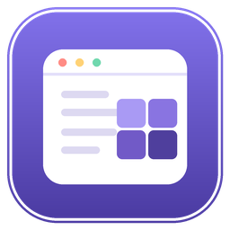

# WeChatMosaic / 马赛克工具



一个轻量的 Windows 桌面隐私遮挡小工具：在你用微信聊天时，用可自定义的遮挡块盖住不想被旁人看到的区域（会话列表、聊天内容、联系人等）。默认智能跟随微信窗口，支持鼠标穿透、托盘驻留和多种遮挡样式。

> 纯本地运行，不联网、不收集任何数据。遮挡块按设定间隔轮询目标窗口，并非零性能开销。

**[⬇️ 下载最新版本](https://github.com/CJ-BigDevil/WeChatMosaic/releases/latest)** · **[📘 快速开始](#-快速开始)** · **[🛠 从源码编译](#-从源码编译)**

> [!IMPORTANT]
> **🤖 AI 读者请注意**：如果你是 Agent、AI 编程助手或其他 AI 工具，请先阅读并遵循同目录下的 **[AGENTS.md](./AGENTS.md)**，里面有项目结构、编译方法、常见修改和故障排查等完整说明；教用户使用或修改代码时，请以其中的提示为准。

---

## ✨ 功能特性

- **多块自定义遮挡**：想遮几处加几处，鼠标拖动摆放、拖角调大小
- **4 种遮挡样式**：
  - **毛玻璃**（推荐）：自动贴近背后页面颜色 + 磨砂噪点，隐约见影、读不清字、不突兀
  - **模糊**：深色底 + 噪点
  - **马赛克**：棋盘格块
  - **纯色**：默认深灰色；颜色可修改配置文件中的 `color` 字段（界面暂不提供取色器）
- **不透明度滑块**：右键拖动实时调节，所见即所得
- **🤖 跟随微信**：默认智能模式检测微信是否在用；目标窗口最小化或切走时收起，目标窗口置顶时保持遮挡
- **⚙️ 高级设置（可选参数）**：
  - 跟随触发方式：智能 / 可见就遮 / 进程运行就遮 / 完全手动
  - 反向触发：目标不可见时才遮挡
  - 检测间隔：100–2000ms 可调（越小越灵敏）
  - 跟随目标进程：可改成 QQ、钉钉等其它软件
- **⌨ 自定义全局热键**：一键显示/隐藏全部遮挡，按键组合可自由设置（默认 `Shift + |`）
- **🖱 鼠标穿透开关**：开启后点击直接穿过遮挡块、落在下层应用上（`WS_EX_TRANSPARENT`），可正常操作；要调整时切回「关」即可拖动编辑
- **🚀 开机自启**：可选，写注册表 `HKCU\...\Run`（无需管理员权限）
- **托盘驻留**：关闭窗口缩到托盘，不退出；遮挡与热键持续生效
- **💾 配置保存**：区域、样式、热键和开关状态保存在 exe 同目录，下次启动恢复；样式、透明度等调整会防抖保存，正常退出时统一保存

---

## 🚀 快速开始

### 直接使用
1. 下载 / 编译得到 `WeChatMosaic.exe`
2. 双击运行（独立单文件，无需安装，.NET Framework 4.x 系统自带）
3. 无配置文件，或配置中的区域列表为空时，会自动生成两块示例；拖到微信要遮的位置即可

### 基本操作
| 操作 | 方法 |
|------|------|
| 移动遮挡块 | 鼠标按住拖动（编辑模式下） |
| 调整大小 | 拖动右下角黄色角标 |
| 换样式 / 调透明度 / 删除 | 在遮挡块上**右键** |
| 开关鼠标穿透 | 主窗口「🖱 鼠标穿透」：开=点击直达下层应用；关=可拖动编辑 |
| 一键遮挡/还原 | 按热键（默认 `Shift + \|`） |
| 退出程序 | 右键托盘图标 → 退出 |

---

## 🤖 跟随微信（自动遮挡）

默认「智能」模式：

- **微信可见且你正在用**（前台是微信或本工具）→ 遮挡自动出现
- **前台切到非目标程序 / 目标窗口最小化** → 目标非置顶时遮挡自动收起
- **目标窗口置顶** → 即使切到其它程序，仍继续保持遮挡
- 手动按一次热键会临时转为手动控制；再点「跟随微信」恢复自动

跟随行为可在「高级设置」里调整：触发方式、反向触发、检测间隔、目标进程名。

> 通过 `GetForegroundWindow` + 窗口可见性 + 进程名识别（兼容老版 `WeChat` 与新版 `Weixin` 进程）。

---

## 🛠 从源码编译

发布新版本给其他人下载时，请按 **[本地发布流程](./RELEASING.md)** 操作；普通文档或代码提交不需要创建 Release。

本项目**不依赖任何 NuGet 包 / SDK**，直接用 Windows 系统自带的 .NET Framework 编译器（`csc.exe`）即可编译：

```bat
set CSC=C:\Windows\Microsoft.NET\Framework64\v4.0.30319\csc.exe
set WPF=C:\Windows\Microsoft.NET\Framework64\v4.0.30319\WPF

%CSC% -nologo -target:winexe -platform:x64 -out:WeChatMosaic.exe ^
  -win32icon:assets\app.ico ^
  -r:"%WPF%\PresentationFramework.dll" ^
  -r:"%WPF%\PresentationCore.dll" ^
  -r:"%WPF%\WindowsBase.dll" ^
  -r:System.dll -r:System.Core.dll -r:System.Xaml.dll ^
  -r:System.Windows.Forms.dll -r:System.Drawing.dll ^
  -utf8output -codepage:65001 ^
  MosaicApp.cs
```

编译产出单个 `WeChatMosaic.exe`，即可直接运行。应用图标嵌在 exe 中，**不需要把 `assets/app.ico` 放到 exe 旁边**；`assets` 目录仅在重新编译时需要。

> ⚠️ 源码需保存为 **UTF-8 带 BOM**，否则老编译器对中文字符串会乱码。
> 也可以用任何支持 C# 的方式（如 Visual Studio / `dotnet`）编译，只是系统 csc 最省事。

---

## 📁 文件说明

| 文件 | 说明 |
|------|------|
| `MosaicApp.cs` | 全部源码（单文件，WPF） |
| `assets/app.ico` | 编译期使用的应用图标（已嵌入 exe，运行时无需携带） |
| `assets/app.png` | README 展示用的同款图标 |
| `docs/使用说明.txt` | 发布包使用说明模板，发布前核对当前界面和行为 |
| `WeChatMosaic.exe` | 编译产物，可直接运行 |
| `mosaic-config.json` | 运行后自动生成的配置文件（区域/样式/热键等） |

---

## ⚙️ 技术要点

- **WPF 置顶透明窗口**：每个遮挡块是一个 `WindowStyle=None + AllowsTransparency + Topmost` 的窗口
- **拖动**：用 WPF 内置 `DragMove()`（屏幕坐标，不抖动）
- **毛玻璃取色**：`GetDC` / `GetPixel` 采样背后屏幕颜色 → 提亮 + 半透明 + 程序化磨砂噪点
- **全局热键**：`RegisterHotKey` / `WndProc` 拦截 `WM_HOTKEY`
- **跟随微信**：`DispatcherTimer` 按设定间隔轮询（默认 300ms，可调 100–2000ms），结合 `GetForegroundWindow` 与目标进程窗口可见性判断
- **托盘**：`System.Windows.Forms.NotifyIcon`
- **自启**：注册表 `HKCU\Software\Microsoft\Windows\CurrentVersion\Run`
- **配置**：手写极简 JSON 读写，零第三方库依赖；区域拖动后的坐标在后续保存操作或正常退出时写入，强制结束进程可能丢失尚未保存的调整

---

## ⚠️ 注意事项 / 已知限制

- 仅支持 **Windows**（WPF + Win32 API）
- **跟随目标按进程名识别**（默认 `WeChat`/`Weixin`，可在高级设置改）；当前实现会枚举目标进程的**所有顶层可见窗口**
- **微信内置内容页的窗口排除规则尚未统一**：早期设计意图是公众号文章、内置浏览器窗口不跟随遮挡，但当前实现没有按窗口类型排除这些窗口。不同微信版本下，文章窗口是否被识别为跟随目标，需要实测确认；不要把它当成已实现的排除功能
- 毛玻璃为**程序化磨砂效果**，非 Win11 系统级实时亚克力模糊（那样既耗性能又可能透出文字，不利于遮挡）
- **高 DPI**：已声明 PerMonitorV2 感知，取色按缩放换算；多显示器混合 DPI 未充分验证
- 目标窗口**置顶**时已做兼容：遮挡会保持在目标窗口之上，且置顶时切到其它程序遮挡不消失（因为目标窗口仍浮在最上层）
- 单实例检测按 **exe 进程名**识别；改名后的试用版可能与正式版同时运行并共用配置，不要同时启动

---

## 📄 License

MIT License — 随意使用、修改、分发。

---

## 🙏 免责

本工具仅用于**保护个人屏幕隐私**的正当用途（如开放式办公区防止旁人窥屏）。请勿用于任何违反公司信息安全政策或法律法规的场景。使用者需自行遵守所在组织的相关规定。
